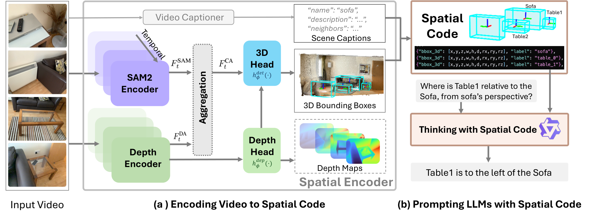
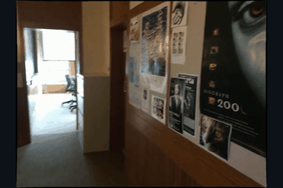
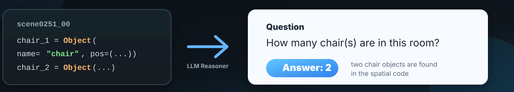

<h2 align="center">Thinking with Spatial Code for Physical-World Video Reasoning</h2>

<p align="center">
  <a href="https://arxiv.org/abs/2603.05591"></a>
  <a href="https://huggingface.co/qicq1c/SpatialCode"></a>
  <a href="https://huggingface.co/datasets/qicq1c/spatialencoder_full"></a>
  <a href="https://huggingface.co/datasets/qicq1c/VSIBench"></a>
</p>

## 🎬 Demo Video

[https://github.com/Beckschen/spatialcode/blob/main/figures/demo_compressed.mp4](https://github.com/user-attachments/assets/2386b070-b4df-46be-aea5-518e41294f0f)


## 📣 News

- **[2026.10]** SpatialCode v1.1: Qwen3-8B with spatial code + scene captions. Welcome our new core contributors [@qic999](https://github.com/qic999) and [@Lucky-Wang-Chenlong](https://github.com/Lucky-Wang-Chenlong)
- **[2026.09]** SpatialCode v1 release: code, SpatialCode model, and preprocessed
  training/evaluation data.
- **[2026.03]** SpatialCode v1 arXiv paper released:
  [arXiv:2603.05591](https://arxiv.org/abs/2603.05591).

## ✨ Overview

<p align="center">
  <a href="https://www.jienengchen.com/">Jieneng Chen</a><sup>1,2</sup>*,
  <a href="https://qic999.github.io/">Qi Chen</a><sup>1</sup>*,
  <a href="https://scholar.google.com/citations?hl=en&user=okLiptEAAAAJ">Ruisheng Yuan</a><sup>1</sup>*,
  <a href="https://mwxinnn.github.io/about/">Wenxin Ma</a><sup>1</sup>*,
  <a href="https://openreview.net/profile?id=~Chenlong_Wang3">Chenlong Wang</a><sup>1</sup>*,
  <a href="https://cs.stanford.edu/~yzzhang/">Yunzhi Zhang</a><sup>2</sup>*<br>
  <a href="https://cocosci.mit.edu/josh-tenenbaum/">Joshua B. Tenenbaum</a><sup>3</sup>,
  <a href="https://jiajunwu.com/">Jiajun Wu</a><sup>2,+</sup>,
  <a href="https://www.cs.jhu.edu/~ayuille1/">Alan Yuille</a><sup>1,+</sup>
</p>

<p align="center">
  <sup>1</sup>Johns Hopkins University &nbsp;&nbsp;
  <sup>2</sup>Stanford University &nbsp;&nbsp;
  <sup>3</sup>Massachusetts Institute of Technology
</p>

<p align="center">* Core contributor.</p>

**TL;DR:** We parse RGB videos into temporally coherent 3D spatial codes so LLMs
can reason directly over explicit physical variables.

<details>
<summary>CLICK for full abstract</summary>

We introduce Thinking with Spatial Code, a framework that transforms RGB video
into explicit, temporally coherent 3D representations for physical-world visual
question answering. We highlight the empirical finding that our proposed spatial
encoder can parse videos into structured spatial code with explicit 3D oriented
bounding boxes and semantic labels, enabling large language models (LLMs) to
reason directly over explicit spatial variables. Specifically, we propose the
spatial encoder that encodes image and geometric features by unifying 6D object
parsing and tracking backbones with geometric prediction, and we further
finetune LLMs with reinforcement learning using a spatial rubric reward that
encourages perspective-aware, geometrically grounded inference.

</details>

SpatialCode follows a modular design. A Spatial Encoder parses videos into
scene-level 3D codes; the reasoning module consumes those codes with an LLM to
answer physical-world spatial questions.

<p align="center">
  <picture>
    <source media="(prefers-color-scheme: dark)" srcset="figures/spatial-code-figure2.png">
    
  </picture>
</p>

## v1 vs. v1.1

| Setting | v1 | v1.1 |
|---|---|---|
| Reasoning LLM | Qwen3-4B-Instruct | Qwen3-8B |
| Reasoning input | Spatial code | Spatial code + scene captions |
| Input prompt | `2D box` | `2D box + SoM prompting` |

## 📁 Code Structure

This repository is organized:
```text
SpatialCode/
|-- Train/
|   |-- SpatialEncoder/     # Spatial Encoder training code
|   |-- RL/                 # Spatial Rubric Reward to Augment Reinforcement Learning
|-- Inference/              # Scene-level 3D bbox inference and merge scripts
|-- Evaluation/             # VSIBench bbox-only evaluation
```

## ⚙️ Setup Environment

Create the environment:

```bash
conda create -n spatialcode python=3.11 -y
conda activate spatialcode

export PIP_CACHE_DIR=/path/to/scratch/pip_cache
export HF_HOME=/path/to/scratch/hf_cache
export XDG_CACHE_HOME=/path/to/scratch/xdg_cache
export OUTLINES_CACHE_DIR=/path/to/scratch/outlines_cache
export MPLCONFIGDIR=/path/to/scratch/matplotlib_cache
export TRITON_CACHE_DIR=/path/to/scratch/triton_cache
export TORCH_EXTENSIONS_DIR=/path/to/scratch/torch_extensions

pip install torch==2.6.0 torchvision==0.21.0 pillow scikit-image shapely tensordict hydra-core iopath submitit tensorboard fvcore webdataset wandb
pip install transformers==4.51.1 torchao==0.9.0 "sglang[srt]==0.4.6.post5" sgl-kernel==0.1.4
pip install --no-deps compressed-tensors==0.9.4
pip install git+https://github.com/facebookresearch/sam2.git
pip install git+https://github.com/ByteDance-Seed/Depth-Anything-3.git
pip install e3nn evo fastapi moviepy addict openai deepspeed accelerate
```


## Python API for a short RGB clip

From the repository root:

```bash
export PYTHONPATH="$PWD/Train/RL${PYTHONPATH:+:$PYTHONPATH}"
```

```python
from spatialcode import video_to_code

scene = video_to_code(
    "walkthrough.mp4",
    model=".",  # downloaded checkpoints
    object_prompts=[{"label": "chair", "bbox": [20, 40, 180, 300]}],
    max_frames=16,
)
scene.to_json("scene_code.json")
```

## 🚀 Quick Start

SpatialCode pipeline:

```text
RGB video -> Spatial Encoder -> spatial code -> LLM reasoner -> VQA answer
```

We use ScanNet `scene0251_00` as an example to demonstrate how to quickly use
SpatialCode. Download the prepared example files and checkpoints from the
SpatialCode model repository. If Hugging Face rate-limits the example download,
run `hf auth login` and retry.

```bash
hf download qicq1c/SpatialCode checkpoint.pt --repo-type model --local-dir .
hf download qicq1c/SpatialCode sam2.1_hiera_large.pt --repo-type model --local-dir .
hf download qicq1c/SpatialCode --repo-type model \
  --include "examples/scene0251_00/*" \
  --include "examples/scene0251_00/**" \
  --local-dir .
```

### 1. Video to Spatial Code

Given the input video for `scene0251_00`, run the Spatial Encoder and merge
frame-level predictions into scene-level spatial code:

```bash
cd Inference

export BOX_DATA_PATH=../examples/scene0251_00/inference_data
export BOX_WEIGHTS_PATH=..
export BOX_EVAL_CKPT=../checkpoint.pt
export BOX_OUTPUT_PATH=../outputs

mkdir -p temp
echo scene0251_00 > temp/scannet_remaining1.txt

bash run_inference_4_shards.sh scannet 1 scannet 1
bash merge.sh scannet scannet merged_bbox_3dconf_top5meanwhl1r_timestamp
```

This produces the spatial code as a JSONL-style file, with one object per line:

```text
../outputs/BoxDet/pred/scannet/scene0251_00/merged_bbox_3dconf_top5meanwhl1r_timestamp.json
```

<div align="center">
<table width="92%">
  <tr>
    <td align="center" width="42%">
      <b>Input Video</b><br><br>
      <br>
      <sub>ScanNet <code>scene0251_00</code></sub>
    </td>
    <td align="center" width="6%">
      <b>→</b>
    </td>
    <td width="52%">
      <b>Generated Spatial Code</b><br><br>
      <pre><code>scene = Scene("scene0251_00")

chair_1 = Object(
    name="chair",
    pos=(4.541, 3.890, 1.283),
    size=(0.607, 0.792, 0.581),
    rot_z=-1.595,
)

chair_2 = Object(
    name="chair",
    pos=(6.460, 5.208, 1.005),
    size=(0.524, 0.844, 0.445),
    rot_z=-1.440,
)</code></pre>
    </td>
  </tr>
</table>
</div>

### 2. Spatial Code to VQA

Start an OpenAI-compatible SGLang server for the LLM reasoner:

```bash
cd Train/RL

MAX_TOTAL_TOKENS=60000 MAX_RUNNING_REQUESTS=64 \
bash scripts/sglang.sh 0 qwen3-4b-instruct 22002
```

Keep the server running, then use the downloaded `vqa_input.json` to run the
LLM reasoning module on the spatial code from another terminal:

```bash
cd Train/RL

python scripts/run_code_to_answer.py \
  --qa_json ../../examples/scene0251_00/vqa_input.json \
  --model_name Qwen/Qwen3-4B-Instruct-2507 \
  --backend api \
  --base_url http://localhost:22002/v1
```

<p align="center">
  
</p>

For details about each component, please refer to the corresponding README:

- Inference details: [Inference](Inference/README.md)
- Evaluation details: [Evaluation](Evaluation/README.md)
- Spatial Encoder training details: [Spatial Encoder Training](Train/SpatialEncoder/README.md)
- RL training details: [RL Training](Train/RL/README.md)

## 📌 citation

If you find this project helpful, please cite:

```bibtex
@article{chen2026spatialcode,
  title={Thinking with Spatial Code for Physical-World Video Reasoning},
  author={Chen, Jieneng and Chen, Qi and Yuan, Ruisheng and Ma, Wenxin and Wang, Chenlong and Zhang, Yunzhi and Tenenbaum, Joshua B. and Wu, Jiajun and Yuille, Alan},
  journal={arXiv preprint},
  year={2026}
}
```

## acknowledgements

This repository builds on and thanks the authors of
[SAM 2](https://github.com/facebookresearch/sam2),
[Depth Anything 3](https://github.com/ByteDance-Seed/depth-anything-3),
[SGLang](https://github.com/sgl-project/sglang),
[Qwen](https://github.com/QwenLM/Qwen3), and
[VSI-Bench](https://github.com/vision-x-nyu/thinking-in-space).
